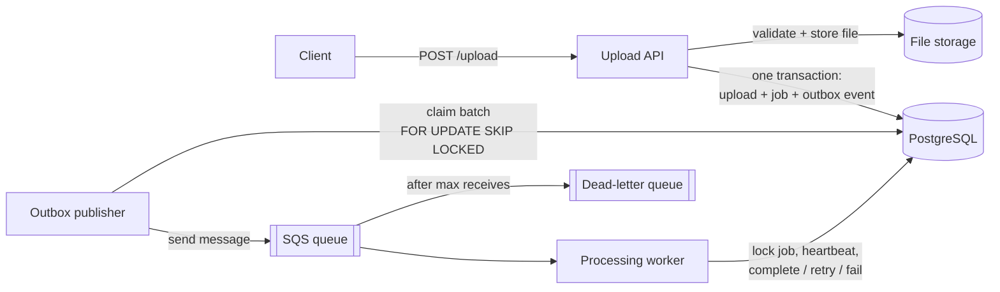

# Video Processor Platform

A backend for uploading and asynchronously processing media files, built with **Java 21 and Spring Boot 4**.
The focus is on the parts that usually break in production: consistency between the database and the message
broker, concurrent workers, crashes in the middle of a job and safe retries.


## At a glance

| | |
|---|---|
| **What it does** | Accepts uploads over REST, stores them, and hands a processing job to workers through Amazon SQS |
| **Key patterns** | Transactional Outbox, leases with claim tokens, pessimistic locking, exponential backoff, dead-letter queue, compensation |
| **Architecture** | Modular monolith organised by feature (`upload`, `outbox`, `processing`) with ports and adapters inside each module |
| **Quality** | 125 tests (unit + integration with Testcontainers for PostgreSQL and SQS), 6 versioned Flyway migrations |
| **Runs with** | `docker compose up`: PostgreSQL, ElasticMQ (local SQS) and the service in a multi-stage, non-root image |

## Architecture



### 1. Upload: never leave orphans behind

`POST /upload` validates the file before touching storage: an allowlist of content types (PNG, JPEG, WebP, GIF, MP4),
a 100 MB size limit and a **magic-number check** so a renamed `.exe` cannot pass as a video. The file is then written
through a `StorageService` port (local file system today, replaceable by S3).

The upload row, its processing job and an outbox event are saved in **a single database transaction**. If that
transaction fails, a **compensation step** deletes the stored file, so storage and database never disagree.

### 2. Transactional Outbox: no lost or phantom messages

Writing to the database and publishing to a queue cannot be one atomic operation. Instead of publishing directly,
the service records an `outbox_event` and a scheduled publisher delivers it:

- Events are claimed in batches with `SELECT … FOR UPDATE SKIP LOCKED`, so several publisher instances can run
  in parallel without blocking each other or sending the same event twice at the same time.
- Each claim gets a **random token and a lease** (`claimed_until`). Updates only succeed if the token still matches
  and the lease is still valid. A publisher that paused for too long cannot overwrite the work of another one.
- Failed deliveries are retried with **exponential backoff**, and the last error is kept for diagnosis.

### 3. Processing jobs: safe under crashes and concurrency

The database, not the queue, is the source of truth for a job's state (`PENDING → PROCESSING → COMPLETED / FAILED`).
SQS delivers at least once, so the worker logic is built to handle duplicates and crashes:

- Jobs are claimed with a **pessimistic row lock** and a lease. A duplicate message for a finished job is
  acknowledged, and one for a job that is still running is deferred until its lease expires.
- Workers extend their lease with **heartbeats**. If a worker crashes, the lease expires and another worker can
  take the job over. Results are only accepted from the worker that still holds the current claim token.
- Attempts are counted **when a job is claimed**, so a job that keeps crashing its worker still reaches the
  attempt limit (5 by default) instead of looping forever.
- Retryable errors are scheduled with backoff (5 s up to 5 min). Permanent errors fail fast. Messages that keep
  failing go to a **dead-letter queue**.
- **Cooperative cancellation**: each task receives a cancellation token so it can stop cleanly when asked.

## Tech stack

- **Language and framework:** Java 21, Spring Boot 4 (Web MVC, Data JPA, Validation), Maven
- **Data:** PostgreSQL 18, Hibernate, Flyway (`ddl-auto: validate`, so the schema is defined by migrations only)
- **Messaging:** Amazon SQS through AWS SDK v2, with ElasticMQ as a local SQS-compatible broker
- **Testing:** JUnit 5, Spring Boot test slices, Testcontainers (PostgreSQL and SQS)
- **Packaging:** Docker multi-stage build, non-root runtime user, Docker Compose with health checks

## Project structure

```
upload-service/src/main/java/com/lorenzosanz/uploadservice
├── upload/       REST endpoint, validation, storage port + local adapter, upload persistence
├── outbox/       outbox events, claim/lease logic, scheduled publisher, SQS sender
├── processing/   processing jobs: claim, heartbeat, completion, failure + retry, SQS consumer
├── shared/       global exception handler and error DTOs
└── health/       health endpoint
```

Each module separates `domain`, `application` (use cases and ports) and `infrastructure` (JPA, SQS, scheduling),
so business rules do not depend on Spring or AWS classes.

## Running locally

Requirements: Docker. Java 21 is only needed to run the tests outside Docker.

```bash
cd upload-service
cp .env.example .env          # set POSTGRES_PASSWORD
docker compose up --build
```

Try it:

```bash
curl http://localhost:8080/health
curl -F "file=@sample.mp4" http://localhost:8080/upload
# {"status":"PENDING","uploadId":"3f0c…"}
```

Within a few seconds the outbox publisher sends the job to the `video-processing` queue in ElasticMQ.

### Running the tests

```bash
cd upload-service
./mvnw test                   # Docker must be running for the Testcontainers integration tests
```

## Configuration

| Variable | Purpose | Default |
|---|---|---|
| `SPRING_DATASOURCE_URL` / `_USERNAME` / `_PASSWORD` | PostgreSQL connection | local database |
| `STORAGE_ROOT_PATH` | Directory where uploaded files are stored | `C:/uploads` |
| `SQS_ENABLED`, `SQS_ENDPOINT`, `SQS_QUEUE_URL`, `AWS_REGION` | SQS connection (ElasticMQ in Compose) | disabled |
| `OUTBOX_PUBLISHER_ENABLED` / `_SCHEDULING_ENABLED` | Turn the outbox publisher on | `false` |
| `OUTBOX_PUBLISHER_BATCH_SIZE`, `_FIXED_DELAY_MS`, `_LEASE_DURATION_SECONDS` | Publisher tuning | `10`, `5000`, `30` |

## Status and next steps

The upload path, the outbox pipeline and the worker's job lifecycle (claim, heartbeat, retry, failure,
cancellation) are implemented and covered by tests. Next steps:

- [ ] Worker runtime that polls the queue continuously and runs the jobs
- [ ] Real video processing with FFmpeg (transcoding and thumbnails)
- [ ] S3 storage adapter next to the local one
- [ ] Endpoint to query an upload's processing status
- [ ] CI pipeline with GitHub Actions, metrics and tracing

## Author

**Lorenzo Sanz Cerveró**, backend Java developer:
[LinkedIn](https://www.linkedin.com/in/lorenzo-sc) · [GitHub](https://github.com/LorenzoSanz)
